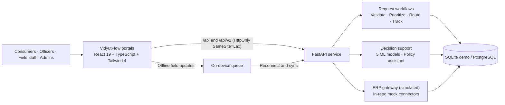

# VidyutFlow — Intelligent Utility Workflow, Predictive AI & Operations Platform

> VidyutFlow is a working prototype, not a deployed UGVCL system. Capabilities marked Simulated are not connected to any real UGVCL, SAP, e-Urja, or 1912 system.

| Capability | Status | Notes |
| :--- | :--- | :--- |
| 5 role-based portals | ✅ Built | Consumer, Subdivision Officer, Field Engineer, Executive Management, System Admin |
| 5 workflow templates | ✅ Built | `new_connection`, `load_extension`, `meter_replacement`, `billing_dispute`, `outage_safety` |
| Offline field sync (queue + replay) | ✅ Built (see [docs/OFFLINE.md](docs/OFFLINE.md)) | IndexedDB + `localStorage` queue, `client_uuid` dedupe; no version-vector merge |
| AES-256-GCM document vault | ✅ Built (application-layer) | `VFENC1` HKDF-SHA256 + AES-256-GCM in `uploads_encrypted/` |
| SHA-256 audit chain | ✅ Built | Serialized `AuditChainHead` + `GET /v1/requests/audit/verify` |
| 5 ML models | ⚠️ Synthetic-trained (not validated on UGVCL data) | Trained on `backend/app/ml/synthetic.py`; strictly advisory |
| SAP S/4HANA IS-U OData gateway | 🟡 Simulated (is_simulated: true) | SAP-shaped OData v4 mock (simulated; not connected to SAP) |
| e-Urja / 1912 CRM fan-out | 🟡 Simulated | 3-System fan-out mock (simulated) (`is_simulated: true`) |
| PostgreSQL production mode | 🟡 Configured, not load-tested | Wired in `docker-compose.yml` via `DATABASE_URL` |
| Disaster recovery | 🟡 Drill script only (not geo-redundant) | Local SQLite backup, SHA-256 checksum & restore drill |
| Hardware / network modernisation | ❌ Out of scope | Software-only prototype; see [docs/INFRA_PROPOSAL.md](docs/INFRA_PROPOSAL.md) |

If evaluating against PS000125, read [docs/PS_GAP_ANALYSIS.md](docs/PS_GAP_ANALYSIS.md) before the feature list.

---

> **Problem Statement `PS000125`** · *Uttar Gujarat Vij Company Limited (UGVCL) · Energy Department · Software*
>
> *Modernizing Electricity Utility Operations Through Workflow Automation, AI Decision-Support, Enterprise ERP Interoperability (Simulated), Application-Layer Security & Backup Tooling*

---

## 1. Executive Summary

**VidyutFlow** is a working prototype addressing subdivision workflow handoffs across **5 operational portals** (`Consumer`, `Subdivision Officer`, `Field Engineer`, `Executive Management`, `System Admin`), **5 seeded configurable utility workflow templates** (`new_connection`, `load_extension`, `meter_replacement`, `billing_dispute`, `outage_safety`, plus Admin-created custom templates), **5 trained `scikit-learn` decision-support & predictive models** (validated on unseen synthetic holdouts at `0.8824` accuracy (synthetic holdout) plus a **team-authored 54-item zero-overlap synthetic/OOD sanity-check set at `0.9074` accuracy (synthetic holdout)**), a **SAP-shaped OData v4 mock (simulated; not connected to SAP)**¹, **offline-resilient field inspection sync**, and **application-layer security + backup script (infra hardening out of scope)**.

- **Zero manual re-entry within prototype portals**: `0` applicant fields re-typed across staff stages; `0` manual routing handoffs; `3` staff transitions from submission to completion ([`docs/WORKLOAD_MEASUREMENT.md`](docs/WORKLOAD_MEASUREMENT.md)).
- **Multilingual citizen & staff UX**: Full 4-language parity across **English, Gujarati (`ગુજરાતી`), Hindi (`हिन्दी`), and Marathi (`मराठी`)**.
- **100% tested API contract**: **50 paths / 55 HTTP operations** dual-served at `/` and `/v1/*` (`X-API-Version: v1`), snapshot-enforced against [`docs/api/openapi.json`](docs/api/openapi.json) with **`55 / 55 (100.0%)` endpoint test coverage** verified in [`docs/verification/r4-api-endpoint-coverage.txt`](docs/verification/r4-api-endpoint-coverage.txt).

---

## 2. Architecture & PS000125 Coverage Matrix

VidyutFlow has three main parts: user portals, a shared API service, and persistent data. Field staff can work offline and sync updates when the connection returns.



| Project part | Purpose |
| :--- | :--- |
| **Portals** | Five role-based workspaces for consumers, subdivision officers, field engineers, management, and system admins. |
| **FastAPI service** | Shared API for authentication, request workflows, analytics, alerts, and simulated integration endpoints. |
| **Field sync** | Queues field updates offline and safely applies each update once after reconnection (see [`docs/OFFLINE.md`](docs/OFFLINE.md)). |
| **Decision support** | Synthetic-trained ML models and the policy assistant provide information to staff; authorized officers make final decisions. |
| **Data and recovery** | SQLite supports local demos; PostgreSQL is configured for deployment. Local backup and restore scripts verify snapshot checksums. |

### PS000125 coverage at a glance

| PS000125 need | VidyutFlow response | Status |
| :--- | :--- | :---: |
| Reduce repeated entry and manual handoffs | Shared request records inside VidyutFlow, automated validation, routing, and assignment. | **Partly built** |
| Provide an integrated ERP and portal experience | Five role-based portals and a simulated API-based ERP gateway (`is_simulated: true`); not connected to real UGVCL systems. | **Simulated** |
| Improve security and accountability | Application-layer role-scoped access, encrypted document storage, audit chain, and SIEM event export. | **Partly built** |
| Support field work with limited connectivity | Offline field queue with authenticated, duplicate-safe sync (no CRDT conflict merge; see [`docs/OFFLINE.md`](docs/OFFLINE.md)). | **Built** |
| Give staff timely operational information | Dashboards, analytics, alerts, and SLA risk views. External SMS/email alert channels are simulated. | **Partly built** |
| Modernize infrastructure and disaster recovery | Local backup, replication, and restore drill scripts are included; physical infrastructure is out of scope ([`docs/INFRA_PROPOSAL.md`](docs/INFRA_PROPOSAL.md)). | **Proposal / Drill** |
| Enable AI and future integration | Five synthetic-trained advisory models, policy assistant, and versioned APIs; model outputs do not approve or reject requests. | **Partly built** |

**Status guide:** See [`docs/PS_GAP_ANALYSIS.md`](docs/PS_GAP_ANALYSIS.md) for the blunt requirement-by-requirement gap matrix and [`docs/REQUIREMENT_MAPPING.md`](docs/REQUIREMENT_MAPPING.md) for repo file references.

---

## 3. Five Trained `scikit-learn` Decision-Support & Predictive Models

> **Provenance & Honesty Boundary:** All 5 models are trained on **synthetic data** (`backend/app/ml/synthetic.py`) with **unseen source-template holdout** so zero template phrasings leak between train and test splits. AI is strictly **advisory (`models_can_approve_or_reject = False`)** — every sanction approval or rejection requires an authenticated human officer ([`docs/ML_REPORT.md`](docs/ML_REPORT.md), [`docs/AI_GOVERNANCE.md`](docs/AI_GOVERNANCE.md)).

| # | Model | Pipeline | Held-Out Synthetic Metric | Majority Baseline | Live Endpoint / Screen |
| :-: | :--- | :--- | :--- | :--- | :--- |
| 1 | **Category Triage** | Word `(1,2)` `TfidfVectorizer` + `LogisticRegression` | **Accuracy `0.8824` (synthetic holdout) · Team-authored synthetic/OOD set `0.9074` (`49/54`, synthetic holdout)** | `0.1667` | `POST /v1/requests` auto-routing |
| 2 | **Severity & Safety Escalation** | Balanced `TF-IDF` + `LogisticRegression` + life-safety rule guardrail | **Balanced Accuracy `0.8750` (synthetic holdout) · `CRITICAL` Recall `100%` (`9/9`, synthetic holdout)** | `0.3333` | Emergency queue prioritization |
| 3 | **Calibrated SLA Breach Risk** | `OneHotEncoder` + Cost-Sensitive `RandomForest` (`threshold = 0.38`) | **Breach Recall `0.8913` (synthetic holdout) · Accuracy `0.8350` (synthetic holdout)** | `0.5400` | `LiveSlaRiskWatchlist` + reason codes |
| 4 | **Billing Anomaly Detector** | `IsolationForest` + deterministic GERC RGPU tariff-slab verifier | **Accuracy `0.9511` (synthetic holdout) · Anomaly Recall `1.000` (synthetic holdout) · F1 `0.8706` (synthetic holdout)** | `0.8356` | `POST /v1/assistant/billing-anomaly` & `LivePredictiveDecisionPanel` |
| 5 | **24h Feeder / DTR Load Forecaster** | `OneHotEncoder` + `GradientBoostingRegressor` | **`R² = 0.9790` (synthetic holdout) · `MAE = 8.89 kVA` (synthetic holdout)** | Mean kVA | `GET /v1/assistant/load-forecast` & 24h kVA chart |

These metrics reflect performance on a team-generated synthetic holdout set. They are not evidence of production performance on UGVCL data.

### Hybrid Operational Assistant (`TF-IDF` Policy RAG + Live SQL + Optional `Gemini`)
- **Offline-first deterministic core (`POST /v1/assistant/chat`)**: Answers live operational queries (including **zone-ranked SLA breach analysis**: *"Which zone has highest breach risk and why?"*), consumer status checks, and cited UGVCL policy passages via local `TfidfVectorizer` cosine retrieval (`backend/data/policies/*.md`) with zero external API dependency.
- **Optional server-side Gemini synthesis**: When `GEMINI_API_KEY` is set on the server, conversational synthesis runs with a strict `3,500ms` timeout and read-only tool grounding, explicitly badged in the UI.

---

## 4. Application-Layer Security, Simulated ERP Gateway, Backup Scripts & Infra Proposal

- **Zero `localStorage` Tokens**: Sessions use `HttpOnly; SameSite=Lax` cookies (`/auth/login?use_cookie=true`) paired with an in-memory, portal-verified session bridge (`backendSession.ts`) that purges legacy storage keys and fails closed on cross-tab mismatches.
- **Magic-Byte Header Check & Always-On AES-256-GCM Vault**: `POST /v1/requests/with-document` checks `%PDF-`, PNG (`\x89PNG\r\n\x1a\n`), JPEG (`FF D8 FF`), and valid UTF-8 `.txt` header signatures (`validate_magic_bytes` in `uploads.py` — blocking extension-spoofed PE/MZ & ELF binaries with `400`; full antivirus/CDR scanning is out of scope), enforces `MAX_UPLOAD_BYTES` (`5 MiB`), and **always** persists encrypted document bytes (`VFENC1` HKDF-SHA256 + AES-256-GCM envelope, never served directly as raw files) into `uploads_encrypted/` (`settings.upload_vault_dir`, overrideable via `UPLOAD_VAULT_DIR`).
- **Tamper-Evident Audit Chain & SIEM Export**: Every state transition, simulated ERP sync, alert dispatch, and template edit appends to a serialized, fork-proof **SHA-256 hash chain** (`AuditChainHead` + `GET /v1/requests/audit/verify`) exportable by Admins in **ArcSight/Wazuh `CEF:0` or JSON** (`GET /v1/system/siem-events`).
- **HTTP Security Headers**: `Content-Security-Policy`, `X-Content-Type-Options: nosniff`, `X-Frame-Options: DENY`, `Referrer-Policy: no-referrer`, `Cache-Control: no-store` on `/auth/*`, and production `Strict-Transport-Security`.
- **ERP integration (simulated)**: SAP-shaped OData v4 mock (simulated; not connected to SAP) (`/v1/erp/sap-odata/*`¹) + 3-System fan-out mock (simulated) across mock SAP FI-CA/IS-U, e-Urja CIS Billing, and GUVNL 1912 Grievance CRM targets via `POST /v1/erp/gateway/propagate/{id}` + in-repo simulated drift check (`GET /v1/erp/reconcile` & `POST /v1/erp/reconcile/{id}`).
- **Backup, SHA-256 Checksum & Local Restore Drill Scripts**: Self-contained `POST /v1/system/dr-failover-drill`, `cold_start_dr_proof.py` ([`docs/verification/r4-cold-start-dr-proof.txt`](docs/verification/r4-cold-start-dr-proof.txt)), `backup.sh`, `offsite_replicate.sh`, and `restore_drill.sh` — verifies local SQLite snapshot checksums, 1-byte tamper rejection, and local file restore (`0` records lost, `PRAGMA integrity_check = ok`; not geo-redundant high availability).
- **Infrastructure Modernisation Proposal (Out of Delivered Scope)**: Hardware and network modernisation are out of scope for this software prototype; proposed reference architecture and indicative BOM are documented separately in [`docs/INFRA_PROPOSAL.md`](docs/INFRA_PROPOSAL.md) and [`docs/INFRASTRUCTURE_BOM_SOURCES.md`](docs/INFRASTRUCTURE_BOM_SOURCES.md).

> ¹ *Simulation disclosure:* All OData v4, CIS Billing, and 1912 CRM endpoints execute against deterministic in-repo mocks (`is_simulated: true` in API metadata) and are not connected to any real SAP or UGVCL server.

---

## 5. Quick Start & Demo Credentials

### Option A — Local Development (Backend + Frontend)

```bash
# 1. Backend (FastAPI on :8000 — auto-seeds demo users, 5 workflow templates & trains 5 sklearn models)
python3 -m venv .venv
.venv/bin/pip install -r backend/requirements.txt
cd backend && ../.venv/bin/uvicorn app.main:app --reload --port 8000

# 2. Frontend (Vite + Node middleware on :3000)
cd frontend && npm install && npm run dev
```

### Option B — Docker Compose

```bash
docker compose up --build
```

### Demo Accounts (Seeded Locally)

| Portal Role | Email | Password | Scope |
| :--- | :--- | :--- | :--- |
| **Consumer** | `consumer@vidyut.local` | `Consumer@123` | Own requests, saved premises, document upload, bill anomaly check |
| **Subdivision Officer** | `officer@vidyut.local` | `Officer@123` | `North` zone queue, approvals, SAP-shaped OData v4 mock sync, alerts |
| **Field Engineer** | `engineer@vidyut.local` | `Engineer@123` | Assigned `North` inspections, offline IndexedDB queue & `client_uuid` sync |
| **Admin / Executive** | `admin@vidyut.local` | `Admin@123` | All zones, AI Governance, 24h Load Forecast, Staff/Template Studio, SIEM stream |

---

## 6. Automated Verification Gates

```bash
# Backend: 124 pytest assertions (55/55 OpenAPI ops, magic-byte & default vault, 5 ML models, OData v4 mock, SIEM, backup drill)
cd backend && ../.venv/bin/pytest -q tests

# Frontend: TypeScript strict check + 38 end-to-end/unit/i18n/security suites + production bundle build
cd frontend && npm run lint && npm test && npm run build
```

> **CI workflow template (`docs/ci.yml`):** Ready-to-enable GitHub Actions workflow template mirroring `make coverage`, `make train`, `make dr-proof`, and `make build`. Stored at `docs/ci.yml` because fine-grained `contents`-only PATs block pushing `.github/workflows/*` — copy to `.github/workflows/ci.yml` via the GitHub Web UI or push with a `workflow`-scoped token to enable hosted Actions runs.

---

## 7. Key Documentation Index

- [`docs/PS_GAP_ANALYSIS.md`](docs/PS_GAP_ANALYSIS.md) — Blunt requirement-by-requirement gap analysis against official `PS000125`
- [`docs/OFFLINE.md`](docs/OFFLINE.md) — Offline field sync: what is implemented vs. unimplemented conflict/version-vector gaps
- [`docs/INFRA_PROPOSAL.md`](docs/INFRA_PROPOSAL.md) — Infrastructure modernisation proposal (explicitly not delivered by prototype)
- [`docs/PS000125_OFFICIAL.md`](docs/PS000125_OFFICIAL.md) — Verbatim official problem statement
- [`docs/REQUIREMENT_MAPPING.md`](docs/REQUIREMENT_MAPPING.md) — Detailed 12-area PS000125 mapping & honesty boundaries
- [`docs/SECURITY.md`](docs/SECURITY.md) & [`SECURITY.md`](SECURITY.md) — Application-layer threat model, AES-256-GCM field/vault encryption & SIEM `CEF:0`
- [`docs/API_CONTRACT.md`](docs/API_CONTRACT.md) & [`docs/api/openapi.json`](docs/api/openapi.json) — Frozen 50-path / 55-operation `/v1` API specification (`100%` endpoint test coverage in `r4-api-endpoint-coverage.txt`)
- [`docs/ML_REPORT.md`](docs/ML_REPORT.md) — 5-model `scikit-learn` evaluation (`0.9074` accuracy (synthetic holdout) on team-authored synthetic/OOD sanity-check set) & human-approval governance
- [`docs/DISASTER_RECOVERY.md`](docs/DISASTER_RECOVERY.md) — Local SQLite backup, SHA-256 checksum & restore drill scripts
- [`docs/TEAM_ROLES.md`](docs/TEAM_ROLES.md), [`docs/VIVA_QUESTION_BANK.md`](docs/VIVA_QUESTION_BANK.md) & [`docs/DEFENCE_QA.md`](docs/DEFENCE_QA.md) — 5-member viva bank & Q&A
