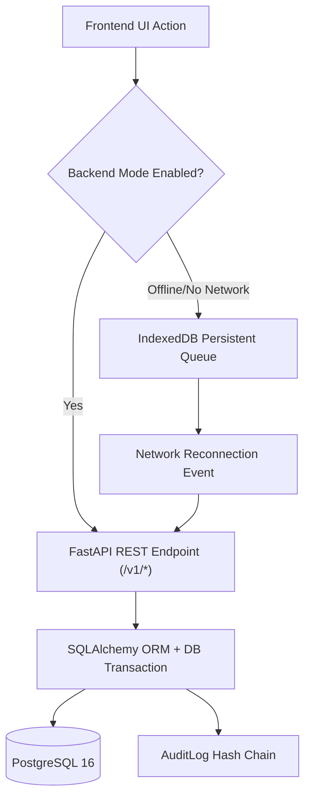

# VidyutFlow: Backend Integration & State Persistence Audit

**Audit Date:** 2026-11-03  
**Auditor:** Full-Stack Architect & Enterprise Integration Specialist  
**Objective:** Identify frontend operations currently using browser memory/localStorage and map the bridge to canonical database persistence.  

---

## 1. Architectural Baseline: Dual-Layer Persistence Analysis

VidyutFlow's frontend (`src/`) was designed to support both a high-fidelity **Standalone Offline/Demo Mode** (for offline demonstration, unit testing, and pitch presentations) and a **Live Enterprise Backend API Mode** (connected to the FastAPI service at `:8000`).

To achieve production readiness, all operations must persist canonically to PostgreSQL/FastAPI, eliminating local React state as the final store.

```text
┌────────────────────────────────────────────────────────────────────────┐
│                        VidyutFlow Application                          │
├───────────────────────────────────┬────────────────────────────────────┤
│       CURRENT LIVE API PATH       │       CURRENT DEMO / LOCAL PATH    │
│  (Persists to PostgreSQL/SQLite)  │ (Stored in React state/IndexedDB)  │
├───────────────────────────────────┼────────────────────────────────────┤
│ - Consumer Registration           │ - Consumer Grievances / Complaints │
│ - Authentication & JWT Sessions   │ - Dispatched Field Work Orders     │
│ - New Connection Applications     │ - Electricity Bill Payment History │
│ - Saved Premises (Profile)        │ - Smart Payment Calendar           │
│ - Field Offline Updates           │ - Consumer Feedback Ratings        │
│ - Phase 13 Field Evidence         │ - Interactive Outage Feeder Toggle │
│ - Cryptographic Audit Hash Logs   │                                    │
│ - Role-scoped Notifications       │                                    │
│ - Workflow Template Editor        │                                    │
└───────────────────────────────────┴────────────────────────────────────┘
```

---

## 2. Granular Entity & State Persistence Audit

### 2.1 Connection Applications (`ConnectionRequest`)
- **Status:** **FULLY CANONICAL (100% Backend Integrated)**
- **Frontend Component:** `ConsumerPortal.tsx` (Application Wizard), `LiveConsumerRequests.tsx`, `LiveRequestQueue.tsx`.
- **Backend API Endpoints:**
  - `POST /v1/requests` (Create new request)
  - `GET /v1/requests/my` (Consumer's own requests)
  - `GET /v1/requests` (Officer request queue with zone/status filters)
  - `PUT /v1/requests/{id}/status` (Status state machine transition)
  - `POST /v1/requests/{id}/assign` (Assign engineer)
- **Database Table:** `connection_requests` (Indexed by `consumer_id`, `zone`, `status`, `created_at`).
- **Verdict:** Production-ready. Verified by `tests/live-api-wiring.test.ts`.

### 2.2 Consumer Grievances & Complaints (`ComplaintRecord`)
- **Status:** **HYBRID / LOCAL FALLBACK (Requires DB Entity Expansion)**
- **Current State:**
  - Customer can submit complaints in `ConsumerPortal.tsx`.
  - In demo mode, records are appended to `AppContext.complaints` in React state.
  - Complaints are enriched with scikit-learn ML classifications (`category_model.joblib`, `severity_model.joblib`), but the resulting complaint records are not yet stored in a dedicated `complaints` SQL table.
- **Remediation Required:**
  - Create SQLAlchemy model `Complaint` in `backend/app/models.py`.
  - Add Alembic migration `003_complaints_table.py`.
  - Mount router `routers/complaints.py` with endpoints:
    - `POST /v1/complaints` (Submit grievance)
    - `GET /v1/complaints/my` (Citizen grievance history)
    - `GET /v1/complaints` (Officer escalation dashboard)
    - `POST /v1/complaints/{id}/reopen` (Linked non-destructive reopen)

### 2.3 Dispatched Field Work Orders (`WorkOrder`)
- **Status:** **HYBRID / PHASE 13 INTEGRATED**
- **Current State:**
  - Work orders are generated in `AppContext` when an officer approves a connection application or complaint.
  - Field engineers update status using `FieldUpdate` (`POST /v1/requests/field-sync`).
  - Evidence photos and checklists are stored canonically via `WorkOrderEvidence` (`POST /v1/evidence`).
- **Gap:**
  - The parent work order record itself is loosely referenced as a string `work_order_id` in `field_updates` and `work_order_evidence` instead of a foreign key to a parent `work_orders` table.
- **Remediation Required:**
  - Formalize `work_orders` table linking `request_id`, `complaint_id`, `assigned_engineer_id`, `scheduled_at`, `status`.

### 2.4 Billing, Tariff Estimation & Payments
- **Status:** **CLIENT-SIDE CALCULATION / MOCK LEDGER**
- **Current State:**
  - `ugvclTariffSchedule.ts` calculates GERC RGPU slabs client-side.
  - Payment modal (`EnterprisePaymentModal.tsx`) updates an in-memory billing mock array in `AppContext`.
  - ML billing anomaly detection (`/v1/assistant/billing-anomaly`) is connected to live FastAPI backend.
- **Remediation Required:**
  - Implement `billing_records` table storing invoice number, consumer ID, billing cycle (bimonthly), units consumed, fixed charges, energy charges, FPPPA charges, electricity duty, payment status, transaction ID.
  - Expose `/v1/billing/{consumer_id}/latest` and `POST /v1/billing/{invoice_id}/pay`.

---

## 3. Integration Adapters: Mock vs Production Analysis

| Integration Domain | Adapter Location | Mock Implementation Behavior | Production Target Specification |
|---|---|---|---|
| **SAP S/4HANA IS-U** | `backend/app/routers/erp.py` (`/v1/erp/sap-odata/ServiceOrders`) | Returns deterministic JSON mirroring SAP OData v4 entity sets with mock etags and `is_simulated: true`. | Needs SAP Cloud Connector / NetWeaver Gateway RFC or OData v4 with OAuth2 Client Credentials grant. |
| **e-Urja CIS (GUVNL)** | `backend/app/erp_adapter.py` (`/v1/erp/gateway/propagate`) | Dispatches fan-out payload to internal simulator and records sync status in `erp_sync_logs`. | Connects to GUVNL e-Urja SOAP/REST web services over Gujarat State Wide Area Network (GSWAN). |
| **GUVNL 1912 Grievance** | `backend/app/routers/erp.py` (`/v1/erp/reconcile`) | Emulates 1912 CRM reconciliation matching ticket IDs and consumer phone numbers. | Webhook listener receiving incident events from centralized GUVNL 1912 Call Center. |
| **Telecom SMS Gateway** | `backend/app/alerts.py` (`alert_dispatches`) | Simulates SMS delivery by logging phone number, DLT template ID, and text body to database. | Integrate BSNL / CDAC / NIC SMS Gateway with TRAI Distributed Ledger Technology (DLT) approved templates. |
| **Email Gateway** | `backend/app/alerts.py` (`alert_dispatches`) | Simulates email delivery to DB log table. | Standard SMTP / Amazon SES connection using credentials configured in `.env`. |

---

## 4. Remediation Action Plan: Achieving 100% Canonical Persistence



1. **Step 1:** Expand `backend/app/models.py` to add `Complaint` and `BillingRecord` models.
2. **Step 2:** Generate Alembic migration scripts.
3. **Step 3:** Mount routers `/v1/complaints` and `/v1/billing` in `main.py`.
4. **Step 4:** Update `AppContext.tsx` so complaint creation, payment recording, and status changes delegate immediately to `fastApiClient` when a session is active.
5. **Step 5:** Maintain offline IndexedDB queueing so field and consumer operations queue gracefully during disconnection.

