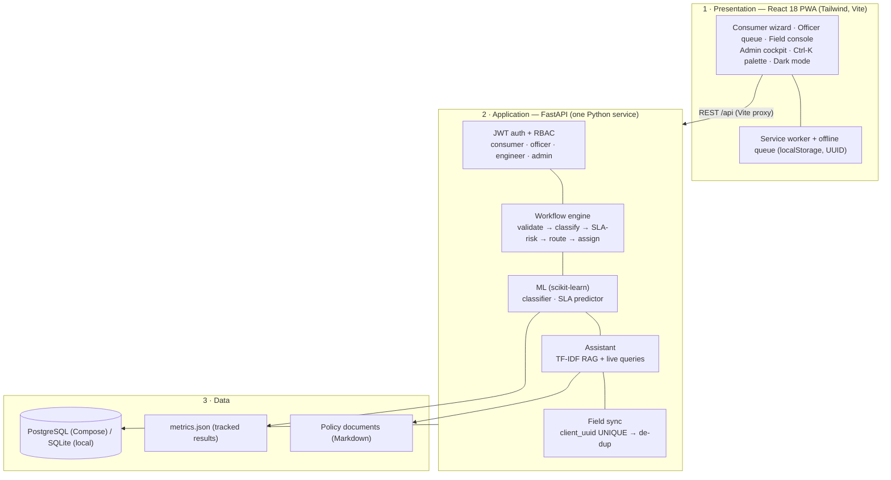

# QUICK AUDIT PACK — paste this whole file to a reviewer who cannot open the repo
> Note for the reviewer: VidyutOS is a **Cloud-to-Edge Orchestration Platform** for utility services
> (control plane + offline edge field clients), not a CPU kernel and not an IoT operating system. There is no bootloader/.asm/QEMU; the equivalents are: bootloader → app startup/seed
> (`backend/app/main.py` lifespan), memory safety → DB transactions + UNIQUE constraints, interrupts → HTTP API +
> audit log, build system → `Makefile` + Docker Compose below. Repo: https://github.com/Yogeshsingh123-LAB/VidyutOS (public)

## 1. README.md
````markdown
<div align="center">

# ⚡ VidyutOS Lite

**A Cloud-to-Edge Orchestration Platform for power-utility services —**
**the control plane for managing, monitoring, and deploying AI policies to field edge clients.**
*“Enter Once, Use Everywhere.”*

[](#-the-problem)
[](#-technology-stack)
[](#-technology-stack)
[](#-technology-stack)
[](#-what-the-bundled-models-show)
[](#-testing--qa)
[](LICENSE)

*Seva First Innovation Challenge · **PS000125 — Future-Ready, Secure and Intelligent IT Infrastructure &
User-Friendly ERP/Portal Ecosystem** · Uttar Gujarat Vij Company Limited (UGVCL) ·
Resource person: hmtcotech2@ugvcl.com · Synopsis due 6 Nov 2026 · Grand Finale 2 Dec 2026*
📋 Official statement: [docs/PS000125_OFFICIAL.md](docs/PS000125_OFFICIAL.md) · Requirement-by-requirement
mapping (built/lite/roadmap, with evidence): [docs/REQUIREMENT_MAPPING.md](docs/REQUIREMENT_MAPPING.md)

**Product definition.** VidyutOS is **not an operating system**. It is the **control plane** for a
utility's cloud-to-edge operations: the cloud side manages, monitors and intelligence-checks every
service request, while the **edge** — field engineers' devices, which must keep working with no
network — executes against it autonomously and syncs back. In this Lite build the edge client is the
engineer PWA; “AI policies” are the classification, routing and SLA-risk policies validated centrally
today and designed to be pushed to edge devices as they are onboarded (roadmap).

> [!IMPORTANT]
> **Core product principle:** VidyutOS is an **AI-assisted workflow & decision-support platform**.
> The ML models classify, prioritise and flag SLA risk — they **never approve or reject a connection**.
> Every final decision (approve / reject / correction) stays with the officer, and every action is audit-logged.

> **On the word “AI” — stated up front, not buried.** Both models are trained on **synthetic data**
> (templates + a noisy labelling rule, in `backend/app/ml/synthetic.py`). Reported accuracies are
> held-out results **against a majority-class baseline**, so the number can never look better than
> “always guessing the most common answer”. They are **not** UGVCL real-world performance.

</div>

---

## 📌 The Problem

**PS000125 — Future-Ready, Secure and Intelligent IT Infrastructure & User-Friendly ERP/Portal
Ecosystem for Automated and Hassle-Free Power Utility Services (UGVCL).**

Work today is split across disconnected ERP, portal and field systems:

| Area | What happens today | Consequence |
| :--- | :--- | :--- |
| **Data entry** | Same applicant details re-typed at every office/system | Errors, delays, “enter many times” |
| **Routing** | Requests moved manually between desks | 4–8 h routing*, lost or stalled files |
| **Field work** | Paper / connectivity-dependent apps | No signal ⇒ no record; re-sync ⇒ duplicates |
| **SLA visibility** | Breaches discovered after the deadline | Reactive firefighting, consumer visits for status |
| **Access** | Multiple logins, fragmented interfaces | Training overhead, weak audit trail |

<sub>*Baseline figures (routing time, lost-request %, ₹/connection, payback) are **planning assumptions from the
design document, not UGVCL published numbers** — see [Scientific honesty](#-scientific-honesty).</sub>

## 💡 What VidyutOS Lite Does

One working end-to-end flow — the **new-connection request** — on a real backend, with everything
else as an explicitly labelled scale-up roadmap:

```
 SUBMIT ─────► VALIDATE ─────► CLASSIFY (ML) ─────► SLA-RISK (ML) ─────► ROUTE & ASSIGN ─────► FIELD (offline-capable) ─────► DECIDE
 Consumer        Rule checks     Category +          Probability +        Zone → officer        UUID-queued entries        Officer approves;
 + document      (no re-entry)   severity            reasons              + engineer            sync, no duplicates      consumer sees status
```

For **every** request the platform can answer, with evidence: *what was checked, which model said
what and why, who owns it now, and when its SLA expires.*

### Product goals → how this build maps to them

| Official goal | VidyutOS framing | Implemented as (status) |
| :--- | :--- | :--- |
| Centralised **control plane** | Manage, monitor & orchestrate every request from one place | FastAPI workflow + audit log + KPI control API (**built**) |
| **Edge Intelligence Simulation / Policy Validation** | Validate AI policies (classify, route, SLA-risk) before they ever reach a device | Two scikit-learn models + reasons, centrally served (**built, synthetic-trained**) |
| **Autonomy at the edge** | Edge clients keep working through **intermittent connectivity** | Engineer PWA offline queue + UUID sync (**built**) |
| **Fleet Management Console** | One console over all “fleet” activity — cases, zones, field staff, risk | Admin/Officer dashboards, SLA redressal, live system status (**built**); device telemetry (**simulated/roadmap**) |
| Deploy policies **to edge devices** | Versioned policy push to onboarded edge hardware | Contract-shaped today (`/assistant`, model metrics); on-device inference & OTA policy rollout (**roadmap**) |

---

## 🚀 Key Features

### 1. 3-Step Guided New-Connection Wizard
Applicant & premises → load, tariff category (`Residential (RGPU)` / `Commercial (NRGP)` /
`Industrial (LTMD)` / `Agricultural (AG)`), phase (auto-suggests 3-phase ≥ 10 kW) & document →
review & submit. One entry is reused by officer, engineer and admin — **no manual re-entry**.

### 2. Rule-Based Workflow Engine (the “kernel” of Lite)
`validate → classify → SLA-risk → route by zone → assign`, in `backend/app/workflow.py`.
SLA clocks by severity: **CRITICAL 24 h · HIGH 48 h · MEDIUM 72 h · LOW 120 h**. Incomplete
requests become `NEEDS_CORRECTION` **with the reason shown to the consumer**, never a silent 500.

### 3. Edge Intelligence Simulation — Policy Validation (two scikit-learn models, control-plane side)
- **Policy: complaint/fault classification** — TF-IDF + Logistic Regression reads the request text, sets
  **category + severity**, and drives routing priority (P1–P4).
- **Policy: SLA-breach risk** — Random Forest over load, documents, zone workload, weekend and
  severity; returns a **probability + human-readable top reasons** (never a bare score).

### 4. Evidence-First Case View
Click any request: 6-step **workflow stepper**, ML category/severity, SLA-risk chip with its
reasons, assigned officer/engineer, document, SLA due time — *what was checked, where, result,
when, and what to do next*.

### 5. Control Interface for Intermittent Connectivity (offline field PWA — the edge client)
Engineer toggles **airplane mode**, records meter serial + inspection remarks offline; entries
queue on-device with a **UUIDv4**. On reconnect they sync — and syncing twice is safe:
the server accepts each UUID **once** (UNIQUE constraint), so duplicates are impossible.

### 6. AI Assistant (no external LLM)
TF-IDF retrieval over policy documents (`backend/data/policies/`) **plus live data queries**:
*“Which requests are likely to breach SLA?”* · *“What is the procedure for a new connection?”* ·
*“How does offline field work sync?”* — answers cite the policy file they came from.

### 7. Fleet Management Console (role-based portals & executive view)
Welcome role-picker → **Consumer / Officer / Engineer / Admin** workspaces with sidebar shell,
**Ctrl-K command palette**, dark mode, live alerts (high SLA risk, needs-correction, pending sync),
KPI bento and charts (by status / zone / category / severity, SLA-risk buckets).

### 8. Full Portal Suites (VidyutOne feature parity, on real data)
- **Global:** skippable cinematic intro (replayable), role-welcome modal, **switch-demo-role** (real
  re-login), interactive **5-step workflow visualizer**, AI-assistant drawer, notifications with
  read/unread state, `#/tab` deep links, toasts.
- **Consumer:** My Connections (meter serial from the real field sync), **demo-estimate bills** with
  slab breakdown + pay/receipt (labelled simulated), payment history, **Complaint Desk** (real —
  ML-triaged & routed), notifications, profile/activity.
- **Officer:** application queue, consumer ledger (derived live), complaint queue, approval center,
  department coordination, **real CSV exports** (requests/audit) + print.
- **Field:** work orders, detailed inspection (reading, seal, terminal, tamper, R/Y/B voltages,
  photo), feeder-patrol checklist, offline-queue manager (inspect/discard/sync), completed-jobs history.
- **Admin/Management:** executive cockpit, SLA-redressal list (overdue-first), **live system status**
  (`GET /system/status`), user directory (`GET /auth/users`, admin-only), RBAC access matrix, settings.
  Feeder/AT&C-style surfaces stay **SIMULATED-labelled** until real telemetry exists.

---

## 📐 Core Invariants (enforced, not just described)

1. **Enter once:** one `ConnectionRequest` row is the single source read by every role —
   $$\text{consumer entry} = \text{officer view} = \text{engineer task} = \text{admin KPI source}$$
2. **Idempotent sync:** for any field entry, $$\text{applied}(\text{client\_uuid}) \le 1$$ —
   re-sending the same UUID returns `{"duplicate": true}` and writes **no** second row.
3. **No silent scores:** every SLA-risk value is stored **with** its reasons list; the UI always renders both.
4. **Auditable decisions:** every create / status change / field sync writes an `AuditLog` row
   (actor, role, action, detail, timestamp). ML never writes an approval.
5. **Fail with reasons:** validation problems ⇒ `NEEDS_CORRECTION` + consumer-visible notes, not exceptions.

## 🔀 Real vs Synthetic vs Simulated — Disclosure

Honesty pattern borrowed across our projects: every surface states what it really is.

| Surface | Mode | What that means |
| :--- | :--- | :--- |
| Requests, workflow, KPIs, audit log | **Real (this backend)** | Computed from the live database on every call |
| Category/severity classifier, SLA predictor | **Synthetic-trained models** | Real inference, synthetic training data; metrics vs baseline below |
| Policy assistant answers | **Real retrieval** | TF-IDF over the 3 bundled policy extracts; sources cited |
| Feeder-health panel (Admin) | **SIMULATED — labelled in UI** | Illustrative only; real SCADA feed is roadmap |
| Seeded demo requests/logins | **Synthetic demo data** | Created on first start so dashboards aren't empty |
| Kafka, Temporal, GraphQL/GIS, Flutter/CRDT, fine-tuned LLM, multi-AZ | **Roadmap — not built** | Slide-ware only; see [Roadmap](#-roadmap--production-integration) |

---

## 🏛 Architecture



Full design notes: [docs/ARCHITECTURE.md](docs/ARCHITECTURE.md) · Reviewer pack: [docs/CODE_REVIEW.md](docs/CODE_REVIEW.md) · Copy-paste audit: [docs/QUICK_AUDIT.md](docs/QUICK_AUDIT.md)

---

## 🚀 Quickstart

```bash
make setup && make backend     # terminal 1 — API :8000 (SQLite fallback, auto-seeds demo data)
make frontend                  # terminal 2 — web app :5173
# — or the full stack in one command —
make up                        # Docker Compose: PostgreSQL + backend + frontend
make test                      # backend tests · make build · make help (all targets)
```

- **Web app:** http://localhost:5173 · **API docs (Swagger):** http://localhost:8000/docs · **Health:** http://localhost:8000/health

### 🔑 Pre-Seeded Demo Credentials (synthetic — change before any real use)

| Role | Email | Password | Sees |
| :--- | :--- | :--- | :--- |
| 🏠 Consumer | `consumer@vidyut.local` | `Consumer@123` | Wizard, my requests, status |
| 🗂️ Officer (North) | `officer@vidyut.local` | `Officer@123` | Queue, SLA flags, approve/reject, audit |
| 👷 Engineer (North) | `engineer@vidyut.local` | `Engineer@123` | Field tasks, offline inspection sync |
| 📊 Admin | `admin@vidyut.local` | `Admin@123` | Executive KPIs, all requests, audit |

South-zone pair (`officer@example.com` / `engineer@example.com`, same passwords) exists to prove
assignment-level authorisation: a South engineer gets **403** on a North case.

### 🎬 Demo in 3–5 Minutes
Wizard submit (+ document) → auto-routed `ASSIGNED` → officer opens the case drawer (stepper +
SLA reasons, Ctrl-K) → engineer in **airplane mode** saves an inspection → sync (sync again —
duplicate ignored) → consumer sees `COMPLETED` → assistant answers the two judge questions.
Full script: [docs/DEMO_SCRIPT.md](docs/DEMO_SCRIPT.md)

---

## 📊 What the Bundled Models Show

| Model | Held-out accuracy | Majority baseline | Test n | Reading |
| :--- | ---: | ---: | ---: | :--- |
| Category classifier | **1.000** | 0.167 | 144 | Perfect — *because synthetic text is templated* (see below) |
| Severity classifier | **1.000** | 0.333 | 144 | Same caveat |
| SLA-breach predictor | **0.794** | 0.625 | 160 | +17 pts over guessing; labels come from a noisy synthetic rule |

**Accuracy is not confidence, and a risk score is not a verdict.** The classifier's 100 % means
“the synthetic vocabulary is separable”, not “real consumer free-text will classify perfectly”.
The SLA number is a **triage probability**: officers act on the *reasons* (missing documents,
high zonal load, ≥ 10 kW approval chain), and a human decides. Reproduce anytime:

```bash
make train     # regenerates models + backend/app/ml/models/metrics.json
```

## 📡 Backend REST API

Interactive docs at **`/docs`**. Base path is proxied as `/api` by the frontend.

| Method | Endpoint | Purpose | Who |
| :--- | :--- | :--- | :--- |
| `GET` | `/health` | Liveness + data notice | public |
| `POST` | `/auth/register` · `/auth/login` | Account + JWT (OAuth2 form) | public |
| `GET` | `/auth/me` | Current user profile | any role |
| `POST` | `/requests` · `/requests/with-document` | Submit (JSON / multipart + file) → auto-workflow | consumer |
| `GET` | `/requests` · `/requests/{id}` | List / detail (role-scoped) | owner, assignee, staff |
| `PATCH` | `/requests/{id}/status` | Approve / reject / progress | officer, engineer*, admin |
| `GET` | `/requests/kpis/summary` | KPIs + by-status/zone/category/severity + risk buckets | role-scoped |
| `POST` | `/requests/field-sync` | Offline inspection sync (UUID de-dup) | engineer*, officer, admin |
| `GET` | `/requests/audit/logs` | Latest 100 audit entries | officer, admin |
| `POST` | `/assistant/chat` | Policy RAG + live SLA/data answers | any role |
| `GET` | `/assistant/ml-metrics` | Tracked model metrics | any role |
| `GET` | `/auth/users` | User directory (never returns hashes) | admin |
| `GET` | `/system/status` | Live service/DB/ML/RAG status + counts | officer, admin |

<sub>*Engineers only on cases assigned to them (403 otherwise, tested).</sub>

## 🖥 Frontend Modules

| View | Contents |
| :--- | :--- |
| **Welcome** | Role-picker cards (autofill demo login), product pitch, animated grid motif |
| **Dashboard** | KPI bento, status/zone/category charts, risk buckets, recent cases, alerts, workflow-at-a-glance |
| **New Connection** | 3-step wizard (premises → tariff/phase/load/document → review) |
| **Requests / Queue** | Search + status/risk filters, risk-first sorting, case drawer (stepper, evidence, actions) |
| **Field Operations** | Connectivity bar, offline queue counter, meter-serial + remarks inspection form |
| **AI Assistant** | Suggested judge questions, cited policy answers, live at-risk list |
| **Insights** | Model cards vs baselines, severity chart, roadmap checklist, simulated feeder panel |
| **Audit Log** | Timestamped actor/action trail (officer & admin) |

## 🛠️ Technology Stack

| Layer | Technology | Notes |
| :--- | :--- | :--- |
| Frontend | React 18, Vite 6, Tailwind CSS 3, Lucide icons | PWA: service worker + web manifest; charts are hand-rolled SVG (no chart dependency to defend) |
| Backend | Python 3.12, FastAPI 0.115, Uvicorn | One service a small team can defend line by line |
| Data | SQLAlchemy 2, PostgreSQL 16 (Compose) / SQLite (local) | Redis service reserved in Compose for roadmap wiring |
| ML / AI | scikit-learn (TF-IDF + Logistic Regression, Random Forest) | Models retrain from synthetic data on first start; binaries not committed |
| Security | JWT (HS256), bcrypt, RBAC + assignment checks, audit log | CORS allowlist via `CORS_ORIGINS`; startup warns on default `SECRET_KEY` |
| DevOps | Docker Compose, Makefile, pytest | `make help` is the single entry point |

## 🗂 Repository Layout

```
VidyutOS/
├── backend/app/            # FastAPI: routers/ · ml/ · assistant/ · workflow.py · security.py
├── backend/data/policies/  # RAG policy extracts (Markdown)
├── backend/tests/          # pytest end-to-end suite
├── frontend/src/           # React PWA: components/ · lib/ · App.jsx
├── frontend/public/        # service worker + PWA manifest
├── docs/                   # ARCHITECTURE · DEMO_SCRIPT · ML_REPORT · ROADMAP · reviews
├── scripts/demo_reset.sh
├── Makefile · docker-compose.yml · LICENSE · README.md
```

---

## 🧪 Testing & QA

```bash
make test          # 4 passed — backend/tests/test_flow.py
make build         # frontend production build
```

| Check | Verifies |
| :--- | :--- |
| End-to-end flow | login (RBAC) → submit → auto-route/assign → officer view → assistant answers → field sync → consumer sees `COMPLETED` |
| **De-duplication** | The same offline UUID synced **twice** ⇒ second response `duplicate: true`, still one record |
| Authorisation | Consumer cannot field-sync (403); South engineer cannot touch a North case (403) |
| ML honesty gate | Both models must **beat their majority baselines** on held-out data, and metrics must carry the synthetic-data notice |
| Admin surfaces | `/auth/users` exposes no hashes and 403s non-admins; `/system/status` reports real DB/ML/RAG checks |

## 🛡️ Security Posture

- **Passwords:** bcrypt (direct, per-user salt); demo passwords are seeded, documented, and demo-only.
- **Tokens:** JWT with role claim; route-level RBAC **plus** assignment-level checks; KPI aggregates are role-scoped (no cross-user leakage).
- **CORS:** exact origin allowlist (`CORS_ORIGINS`), never `*` with credentials; the app prints a warning if the default `SECRET_KEY` is still set.
- **Audit:** append-only log of every mutation with actor + role; audit entries are written in the same transaction as the change.
- **Offline integrity:** server-side UUID uniqueness is the de-dup authority — the client queue can retry freely.
- **Accepted demo trade-offs (production homework, stated plainly):** JWT in `localStorage` (→ httpOnly cookie), no login rate-limiting yet, uploads store filename only (→ validated object storage), officer actions not zone-scoped.

## ⚖️ Scientific Honesty

1. **Synthetic data:** templated request text ⇒ classifier accuracy is inflated vs real free-text; SLA labels follow a synthetic rule + noise. Neither number is UGVCL performance.
2. **Assumed baselines:** routing-time, lost-request, cost and payback figures in the design document are **targets/assumptions**, not measured or published UGVCL values.
3. **Simulated surfaces are labelled:** the feeder panel says SIMULATED in the UI; seeded requests say Synthetic.
4. **Risk ≠ outcome:** the SLA predictor flags *likelihood with reasons* for triage; it does not predict a guaranteed breach, and officers make the final call.
5. **Scope discipline:** anything not in the 3–5 minute demo (Kafka, GIS, Flutter, fine-tuned LLM…) is roadmap, and the README says so wherever it is mentioned.

## 🛣 Roadmap / Production Integration

The Lite build is deliberately shaped so real systems slot in without a rewrite:

1. **Event backbone** — publish workflow transitions to Kafka; move long workflows to Temporal/Camunda.
2. **Richer clients** — GraphQL + GIS outage map + WebSockets on the same REST core; Flutter app reusing the UUID sync contract (Couchbase/CRDT).
3. **Smarter assistant** — fine-tuned LLM in a private VPC behind the existing `/assistant/chat` contract; policy corpus grows from 3 extracts to the real manual set.
4. **Platform hardening** — Zero Trust, Vault-managed secrets, httpOnly sessions, multi-AZ failover, backup/restore drills (`backend/scripts/backup.sh` is the seed of this).
5. **Real telemetry** — SCADA/feeder feeds replace the simulated panel; predictive maintenance models train on sensor history instead of synthetic rules.

Detail: [docs/ROADMAP.md](docs/ROADMAP.md) · UX-upgrade provenance: [docs/VIDYUTONE_UPGRADE.md](docs/VIDYUTONE_UPGRADE.md)

## 📚 Documentation Quick Links

| Doc | For |
| :--- | :--- |
| [docs/DEMO_SCRIPT.md](docs/DEMO_SCRIPT.md) | Judges / demo rehearsal (synopsis video + Dec 2 defence) |
| [docs/ARCHITECTURE.md](docs/ARCHITECTURE.md) | As-built architecture |
| [docs/ML_REPORT.md](docs/ML_REPORT.md) | Models, retraining, caveats |
| [docs/SYNOPSIS_ABSTRACT.md](docs/SYNOPSIS_ABSTRACT.md) | Portal abstract draft (submit by 5–6 Nov) |
| [docs/DECK_OUTLINE.md](docs/DECK_OUTLINE.md) | 12-slide deck (PDF ≤ 20 MB) |
| [docs/CODE_REVIEW.md](docs/CODE_REVIEW.md) · [docs/QUICK_AUDIT.md](docs/QUICK_AUDIT.md) | Reviewer packs |

---

## 👥 Team — 5 Roles

Work is split by repo module so every file has one owner, with deliverables, RACI, hand-offs,
smaller-team merges and the Nov 6 / Dec 2 checklists in [docs/TEAM_ROLES.md](docs/TEAM_ROLES.md).

| Role | Owner | GitHub | Designation |
| :--- | :--- | :--- | :--- |
| 1 · Backend & Workflow | **Yogesh Kumar Singh** | [@Yogeshsingh123-LAB](https://github.com/Yogeshsingh123-LAB) | 👑 **Team Leader** (repo owner) |
| 2 · Frontend & PWA | **Utsav** | [@utsavmandalia-01](https://github.com/utsavmandalia-01) | Collaborator |
| 3 · ML & AI | **Aakash Kumar Singh** | [@1006coder](https://github.com/1006coder) | Collaborator |
| 4 · DevOps, Security & QA | **Sandip** | [@SANDIP29072007](https://github.com/SANDIP29072007) | Collaborator |
| 5 · Docs, Demo & Product | **Arnav** | [@coderAJ22](https://github.com/coderAJ22) | Collaborator |

## 📜 License

MIT — see [LICENSE](LICENSE). Built for the Seva First Innovation Challenge 2026 (PS000125, UGVCL);
synthetic demo data provided for demonstration and evaluation. Not an official UGVCL system.
````

## 2. Directory structure (`tree`, tracked files only)
```
├── backend
│   ├── app
│   │   ├── assistant
│   │   │   ├── __init__.py
│   │   │   └── service.py
│   │   ├── ml
│   │   │   ├── models
│   │   │   │   └── metrics.json
│   │   │   ├── __init__.py
│   │   │   ├── predict.py
│   │   │   ├── synthetic.py
│   │   │   └── train.py
│   │   ├── routers
│   │   │   ├── __init__.py
│   │   │   ├── assistant.py
│   │   │   ├── auth.py
│   │   │   ├── requests.py
│   │   │   └── system.py
│   │   ├── __init__.py
│   │   ├── audit.py
│   │   ├── config.py
│   │   ├── db.py
│   │   ├── deps.py
│   │   ├── main.py
│   │   ├── models.py
│   │   ├── security.py
│   │   └── workflow.py
│   ├── data
│   │   └── policies
│   │       ├── new_connection.md
│   │       ├── offline_field_work.md
│   │       └── sla_and_escalation.md
│   ├── scripts
│   │   ├── backup.sh
│   │   └── train_models.py
│   ├── tests
│   │   └── test_flow.py
│   ├── .env.example
│   ├── Dockerfile
│   ├── requirements-dev.txt
│   └── requirements.txt
├── docs
│   ├── ARCHITECTURE.md
│   ├── CODE_REVIEW.md
│   ├── DECK_OUTLINE.md
│   ├── DEMO_SCRIPT.md
│   ├── INFRASTRUCTURE_ROADMAP.md
│   ├── MAIL_TO_UGVCL.md
│   ├── MAIL_TO_UGVCL.pdf
│   ├── ML_REPORT.md
│   ├── PS000125_OFFICIAL.md
│   ├── QUICK_AUDIT.md
│   ├── README.md
│   ├── REQUIREMENT_MAPPING.md
│   ├── ROADMAP.md
│   ├── SYNOPSIS_ABSTRACT.md
│   ├── TEAM_ROLES.md
│   └── VIDYUTONE_UPGRADE.md
├── frontend
│   ├── public
│   │   ├── manifest.webmanifest
│   │   └── sw.js
│   ├── src
│   │   ├── components
│   │   │   ├── RequestDrawer.jsx
│   │   │   ├── Shell.jsx
│   │   │   ├── featurePanels.jsx
│   │   │   ├── panels.jsx
│   │   │   └── ui.jsx
│   │   ├── lib
│   │   │   └── format.js
│   │   ├── App.jsx
│   │   ├── api.js
│   │   ├── index.css
│   │   └── main.jsx
│   ├── Dockerfile
│   ├── index.html
│   ├── package-lock.json
│   ├── package.json
│   ├── postcss.config.js
│   ├── tailwind.config.js
│   └── vite.config.js
├── scripts
│   └── demo_reset.sh
├── .editorconfig
├── .gitignore
├── LICENSE
├── Makefile
├── README.md
└── docker-compose.yml
```

## 3. Makefile (run `make help`; verified: `make train`, `make test`, `make build` all pass)
```makefile
# VidyutOS Lite — one-command build/run/test (no hardcoded local paths; run from repo root)
.DEFAULT_GOAL := help
.PHONY: help setup train backend frontend dev test build up down clean demo-reset

help: ## Show available targets
	@grep -E '^[a-zA-Z_-]+:.*?## ' $(MAKEFILE_LIST) | awk 'BEGIN{FS=":.*?## "}{printf "  make %-12s %s\n", $$1, $$2}'

setup: ## Install backend + frontend dependencies
	cd backend && pip install -r requirements.txt -r requirements-dev.txt
	cd frontend && npm install

train: ## Retrain both ML models on synthetic data (writes metrics.json)
	cd backend && python scripts/train_models.py

backend: ## Run API locally (SQLite fallback) on :8000
	cd backend && uvicorn app.main:app --host 0.0.0.0 --port 8000

frontend: ## Run web app locally on :5173 (proxies /api to :8000)
	cd frontend && npm run dev

test: ## Backend test suite (end-to-end flow, RBAC, offline de-dup, ML)
	cd backend && python -m pytest -q

build: ## Production frontend build
	cd frontend && npm run build

up: ## Full stack with PostgreSQL via Docker Compose
	docker compose up --build

down: ## Stop Docker Compose stack
	docker compose down

demo-reset: ## Remove local SQLite demo databases (re-seeded on next start)
	./scripts/demo_reset.sh

clean: demo-reset ## Remove demo DBs and build artefacts
	rm -rf frontend/dist backend/.pytest_cache
	find . -type d -name __pycache__ -prune -exec rm -rf {} +
```

## 4. Red-flag map (reviewer's OS checklist → this codebase)
| Reviewer area | Look here instead | Status |
|---|---|---|
| Bootloader / startup | `backend/app/main.py` lifespan: create tables → train models → seed users/requests | Clean startup log, warns on default SECRET_KEY |
| Memory / corruption | SQLAlchemy transactions; `client_uuid` UNIQUE in `backend/app/models.py` | Duplicate sync writes impossible; tested ×2 sync |
| Interrupts / events | Routers in `backend/app/routers/`, every mutation writes `AuditLog` | RBAC + assignment-level 403 checks, tested |
| Stack / crashes | Pydantic validation + workflow `validate()` → NEEDS_CORRECTION instead of 500 | Invalid input returns reasons, not crashes |
| Build portability | `Makefile` + `docker-compose.yml`, lockfiles, no absolute paths | `make test` 2 passed · `make build` OK |
