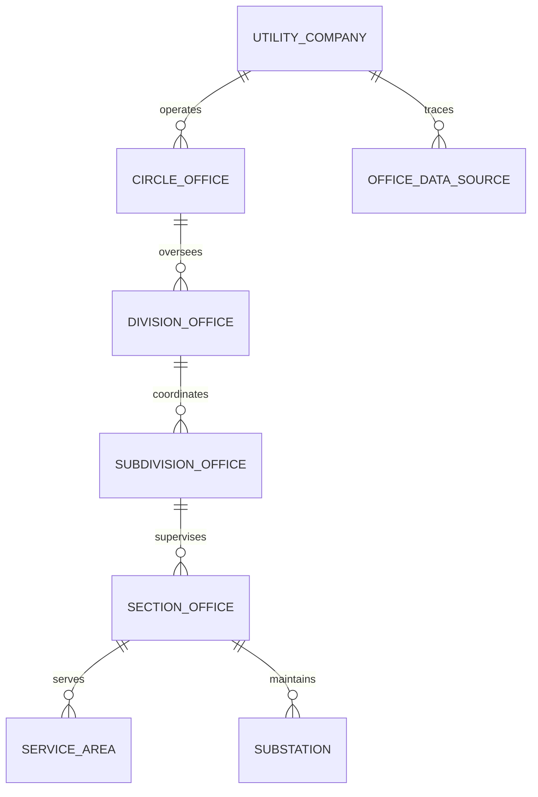

# UGVCL Organizational Hierarchy Database Architecture

## 1. Relational Entity Design

VidyutFlow implements a normalized relational schema reflecting the multi-tier hierarchy of power distribution utilities. While initially seeded for UGVCL, the schema is multi-utility capable via `utility_id` partitioning.



---

## 2. Table Specifications & Constraints

### 1. `utilities`
- `id` (VARCHAR(36), PK): UUID
- `code` (VARCHAR(50), UNIQUE): e.g., `UGVCL`
- `name` (VARCHAR(200)): `Uttar Gujarat Vij Company Limited`
- `legal_name_gu` (VARCHAR(200)): Gujarati official name
- `cin` (VARCHAR(50)): Corporate Identification Number
- `headquarters` (VARCHAR(255)): Official corporate address
- `website`, `helpline`: Official communication channels
- `is_active` (BOOLEAN, DEFAULT true)
- `created_at`, `updated_at`: Audit timestamps

### 2. `circles`
- `id` (VARCHAR(36), PK): UUID
- `utility_id` (VARCHAR(36), FK -> `utilities.id`, ON DELETE CASCADE)
- `code` (VARCHAR(50), UNIQUE): e.g., `CIR-MSH`, `CIR-SAB`, `CIR-HMT`, `CIR-PLN`
- `name` (VARCHAR(150)): Circle name
- `phone`, `email`, `address`: Contact details
- `districts_covered` (JSON/TEXT): Array of district strings (e.g., `["Mehsana", "Patan"]`)
- `latitude`, `longitude` (FLOAT): Geographic centroid coordinates
- `is_active` (BOOLEAN, DEFAULT true)

### 3. `divisions`
- `id` (VARCHAR(36), PK): UUID
- `circle_id` (VARCHAR(36), FK -> `circles.id`, ON DELETE RESTRICT)
- `code` (VARCHAR(50), UNIQUE): e.g., `DIV-KDI-03`, `DIV-GNR-01`
- `name` (VARCHAR(150)): Division name
- `phone`, `email`, `address`: Contact details
- `talukas_covered` (JSON/TEXT): Array of talukas (e.g., `["Kadi"]`)
- `is_active` (BOOLEAN, DEFAULT true)

### 4. `subdivisions`
- `id` (VARCHAR(36), PK): UUID
- `division_id` (VARCHAR(36), FK -> `divisions.id`, ON DELETE RESTRICT)
- `circle_id` (VARCHAR(36), FK -> `circles.id`, ON DELETE RESTRICT)
- `code` (VARCHAR(50), UNIQUE): e.g., `SUB-DIV-KDI-03-CITY`, `SUB-DIV-KDI-03-RUR`
- `name` (VARCHAR(150)): Subdivision name
- `phone`, `email`, `address`: Contact details
- `taluka` (VARCHAR(100)): Primary taluka
- `pin_code` (VARCHAR(10)): Postal code
- `is_rec` (BOOLEAN, DEFAULT false): Flag identifying Rural Electrification Corporation schemes
- `working_hours` (VARCHAR(100), DEFAULT '09:30 AM - 06:10 PM')
- `is_active` (BOOLEAN, DEFAULT true)

### 5. `sections`
- `id` (VARCHAR(36), PK): UUID
- `subdivision_id` (VARCHAR(36), FK -> `subdivisions.id`, ON DELETE RESTRICT)
- `code` (VARCHAR(50), UNIQUE): e.g., `SEC-SUB-DIV-KDI-03-RUR-01`
- `name` (VARCHAR(150)): Section name
- `phone`, `email`, `address`: Contact details
- `is_active` (BOOLEAN, DEFAULT true)

### 6. `service_areas`
- `id` (VARCHAR(36), PK): UUID
- `section_id` (VARCHAR(36), FK -> `sections.id`, ON DELETE RESTRICT)
- `subdivision_id` (VARCHAR(36), FK -> `subdivisions.id`, ON DELETE RESTRICT)
- `code` (VARCHAR(50), UNIQUE): Unique zone identifier
- `name` (VARCHAR(150)): Zone/Feeder corridor name
- `pin_code` (VARCHAR(10))
- `villages_json` (JSON/TEXT): List of villages/towns covered
- `feeders_json` (JSON/TEXT): Associated 11kV feeders
- `consumer_prefix_patterns` (JSON/TEXT): Serial prefix bindings (e.g. `["04281", "02194"]`)
- `is_active` (BOOLEAN, DEFAULT true)

### 7. `substations`
- `id` (VARCHAR(36), PK): UUID
- `section_id` (VARCHAR(36), FK -> `sections.id`, ON DELETE RESTRICT)
- `code` (VARCHAR(50), UNIQUE): e.g., `SS-SEC-01`
- `name` (VARCHAR(150)): e.g., `66kV Kadi Substation`
- `voltage_kv` (VARCHAR(50)): `66/11 kV`, `11/0.433 kV`
- `capacity_mva` (FLOAT): e.g., `20.0`
- `operational_status` (VARCHAR(50)): `OPERATIONAL`, `MAINTENANCE`, `PLANNED`

---

## 3. Indexing Strategy & Query Performance

Composite and foreign key indexes ensure sub-millisecond retrieval during consumer lookup and hierarchy rendering:

```sql
-- Fast parent traversal
CREATE INDEX idx_divisions_circle_id ON divisions(circle_id);
CREATE INDEX idx_subdivisions_division_id ON subdivisions(division_id);
CREATE INDEX idx_subdivisions_circle_id ON subdivisions(circle_id);
CREATE INDEX idx_sections_subdivision_id ON sections(subdivision_id);
CREATE INDEX idx_service_areas_section_id ON service_areas(section_id);
CREATE INDEX idx_substations_section_id ON substations(section_id);

-- Code uniqueness & lookup
CREATE UNIQUE INDEX idx_circles_code ON circles(code);
CREATE UNIQUE INDEX idx_divisions_code ON divisions(code);
CREATE UNIQUE INDEX idx_subdivisions_code ON subdivisions(code);
CREATE UNIQUE INDEX idx_sections_code ON sections(code);

-- Status filter optimization
CREATE INDEX idx_circles_active ON circles(is_active);
CREATE INDEX idx_divisions_active ON divisions(is_active);
CREATE INDEX idx_subdivisions_active ON subdivisions(is_active);
CREATE INDEX idx_subdivisions_rec ON subdivisions(is_rec);
```

---

## 4. Reorganization & Immutability Rules

1. **Never Delete Historical Offices**: When an office is renamed or reorganized into two new subdivisions, its `is_active` flag is set to `false`. Historical work orders, audit logs, and connection ledgers retain their foreign key association.
2. **Effective Dates**: Reorganizations record effective dates so regulatory reports (GERC FY) can query the exact organizational shape as of any past timestamp.
3. **No Orphan Entities**: Office creation strictly validates parent existence (`HTTP 422`). Deletions are restricted (`ON DELETE RESTRICT`) so a Circle or Division with active children cannot be accidentally dropped.

