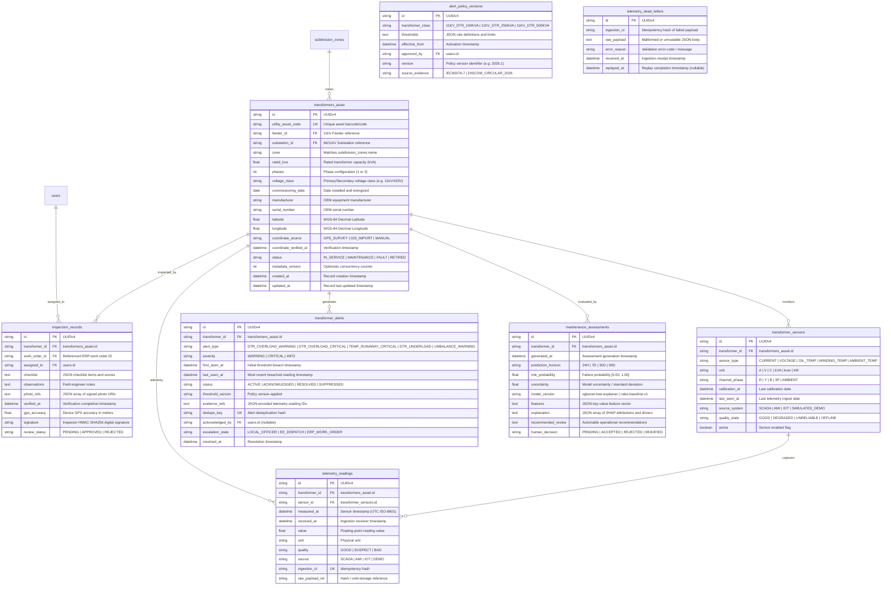

# Phase 12 — Smart Transformer Health, Telemetry & Overload Rules
## Entity-Relationship Diagram (ERD) & Database Specification

### 1. Architectural Overview
Phase 12 introduces 8 core relational entities into the VidyutFlow PostgreSQL/SQLite operational schema, maintaining strict foreign-key integrity, spatial indexing, composite time-series telemetry indexing, and audit trail linkability across the existing ERP and Work Order ecosystem.

---

### 2. Indexes and Performance Strategy
1. **Time-Series Telemetry**: `ix_telemetry_transformer_measured` (`transformer_id`, `measured_at DESC`). Enables sub-5ms telemetry lookups over the sliding 24-hour window.
2. **Alert Deduplication**: `transformer_alerts.dedupe_key` (Unique constraint) prevents redundant notifications during sustained threshold violations.
3. **Idempotency**: `telemetry_readings.ingestion_id` prevents duplicate readings from retry bursts or poor network conditions in field gateways.
4. **Subdivision Scoping**: `transformers_asset.zone` indexed to support fast tenant/subdivision partitioning.

